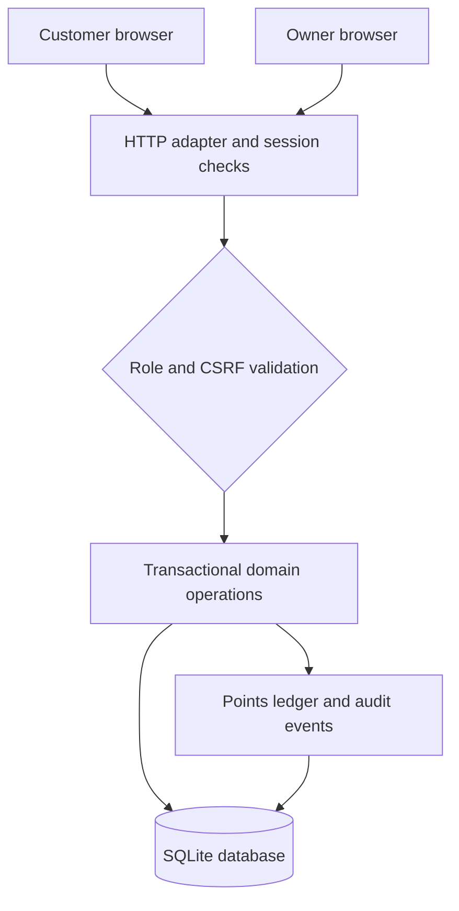
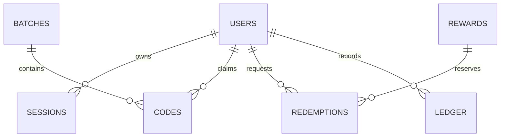
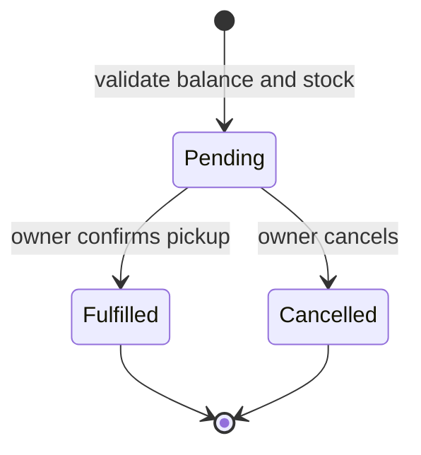

# Architecture

## Stack choices

- **Python standard library:** small, readable implementation that runs without package downloads. `http.server` is deliberately a local-demo adapter, not a production hosting recommendation. Business rules are separated so a Flask/Django adapter can replace it later.
- **SQLite:** durable relational data, foreign keys, constraints and transactions on one server. `BEGIN IMMEDIATE` serializes writes, preventing two claims or redemptions from winning against the same state. At larger scale, migrate to PostgreSQL with equivalent row-level transaction semantics.
- **HTML/CSS/vanilla JavaScript:** no frontend build required; UI remains easy to explain. Server is authoritative; disabling a button is only a usability aid.
- **No runtime AI:** issuing points and validating purchases must use deterministic rules. AI was a development assistant only.

## Components and trust boundary

`app.py` derives the acting user from a server-side session, never a user ID in the body. It enforces owner-only routes before invoking `core.py`. The core is a trusted internal API; it is not separately exposed. The CLI is a privileged local provisioning mechanism and must be restricted to the operator.

## Data model

| Table | Important fields and relationships |
|---|---|
| users | unique lowercase username; salted scrypt password hash; owner/customer role; nonnegative points |
| sessions | SHA-256 of random cookie token; user FK; CSRF token; expiry |
| batches | label; fixed points per box; expiry timestamp; revoked flag |
| codes | hash primary key; batch FK; nullable claimant user FK; claim time |
| rewards | name; positive integer cost; nonnegative available stock; active flag |
| redemptions | customer FK; reward FK; original cost snapshot; status; timestamp |
| ledger | customer FK; signed point delta; reason; timestamp |
| audit | actor ID; event; nonsecret detail; timestamp |
| attempts | throttle bucket and timestamp; old entries removed on the next attempt |

The mutable balance is a cache updated atomically with ledger entries. No points-editing endpoint is provided. Rewards keep current catalog names; redemptions retain the original cost but not the original name. All times are Unix timestamps and the UI displays local browser time.

## Claim protocol

1. Owner generates random 16-byte values using `secrets.token_hex(16)`.
2. Raw codes are returned once for printing; only hashes are inserted into `codes`.
3. Customer signs in and submits a code from inside a sealed box. Spaces/hyphens and lowercase are normalized.
4. After rate limiting, a write transaction verifies code existence, unclaimed state, unrevoked batch and expiry.
5. Claimant, customer balance, ledger and successful audit event commit together. A concurrent request then sees the claimed state.
6. Rejections return a generic availability error without identifying the claimant. A rejection audit is committed before raising the public error.

## Redemption state transitions

Creating Pending deducts points and reserves one stock unit. Cancellation restores the original cost snapshot and one stock unit exactly once. Fulfillment does not deduct again. Terminal transitions cannot repeat. Renaming/repricing a reward does not change a pending refund amount. Editing available stock explicitly replaces the current unreserved quantity; already reserved units are not counted in that figure.

## Security and fraud controls

- Scrypt password hashes use a random per-password salt (N=16384, r=8, p=1). Passwords are never returned to browsers.
- Cookie tokens use 32 random bytes; only their SHA-256 hashes are stored. Cookies are HttpOnly and SameSite=Strict, with configurable Secure. Sessions expire after eight hours.
- All POSTs require JSON plus a custom header; no CORS is enabled. Authenticated mutations also require a session-bound CSRF token. Cross-site fetch metadata is rejected when supplied.
- Strict owner/customer role checks, request size ceiling of 8 KiB, integer validation and parameterized SQL.
- Displayed user data is HTML escaped. CSP permits local scripts/styles only and prevents framing.
- Claim rate: 15 attempts/customer/15 minutes. Login: 20 attempts/address/15 minutes (successful attempts count too). Registration: 10/address/15 minutes.
- Codes cannot be reused even by another customer. Guessing is made impractical by entropy plus throttling. Rate limits persist in SQLite across server restarts.
- Owners can revoke unused codes in compromised batches; earlier points are not clawed back automatically.

## Residual risks and operational limits

A hidden code proves possession, not payment. Someone can steal unprinted codes or open stock; tamper-evident packaging and secure printing procedures are essential. Owner accounts can issue arbitrary rewards/codes and must be trusted. Code exports cannot be recovered, and a lost HTTP response after batch creation also loses its export. Revoke/reissue rather than regenerating known codes.

Rate limits are not a full anti-fraud solution. An attacker can create accounts or distribute requests; add verified identities and risk monitoring for production. Reverse proxies change the observed client IP; do not blindly trust forwarded headers. The simple server has no robust connection-level denial-of-service controls. Failed logins use generic messages but are not designed to eliminate timing-based account enumeration.

Claim retries are safe against duplicate points because the code itself is unique. Reward redemption requests have no idempotency key: a deliberate second request can buy a second reward if balance and stock permit. The UI disables submission while pending; introduce idempotency keys for production retry handling.

Audit/ledger screens show the latest 100 records; aggregate owner metrics cover all records. Pagination, automated backups, migrations, account recovery, alerts and retention tooling are future work. No multi-server support, shipping, cash conversion or receipts are implied.
